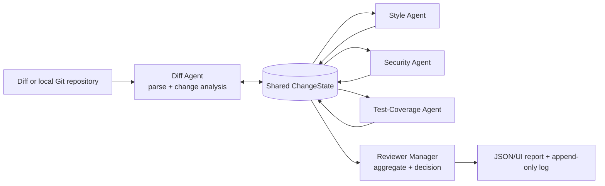

# Architecture

After the Diff Agent, `asyncio.gather` fans work out to three independent specialist coroutines (plus the completed diff specialist), which write findings under a lock to `ChangeState`. The Reviewer Manager fans results in, deduplicates them, and applies the deterministic policy. Semantic Kernel supplies the real `Kernel` and per-agent registered callable plugin objects; offline mode deliberately invokes the registered analysis implementations locally, without an LLM or submitted-code execution.
